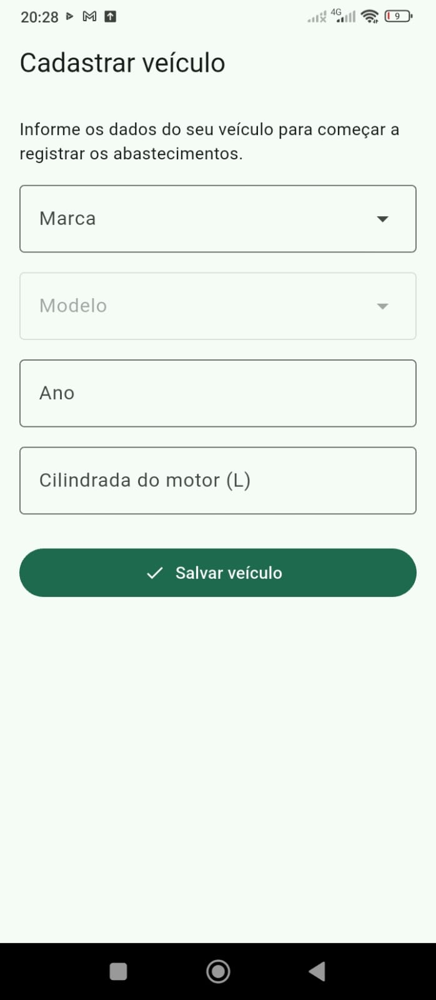
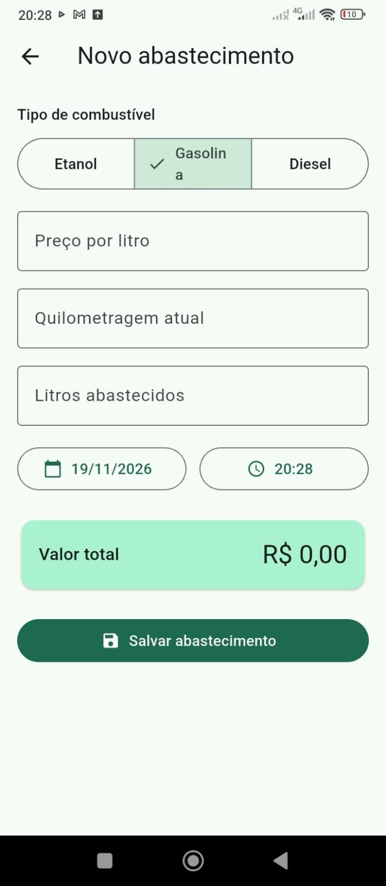
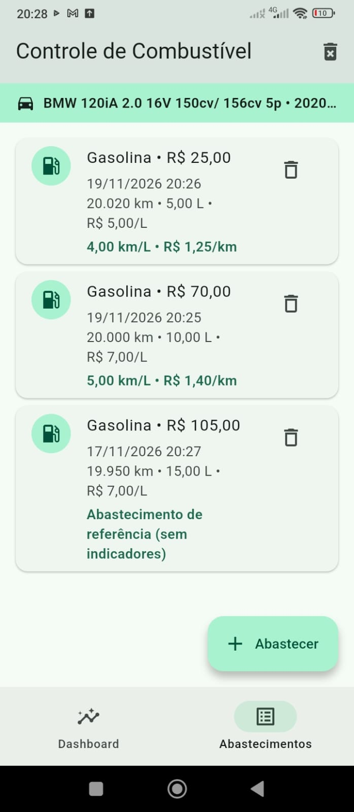
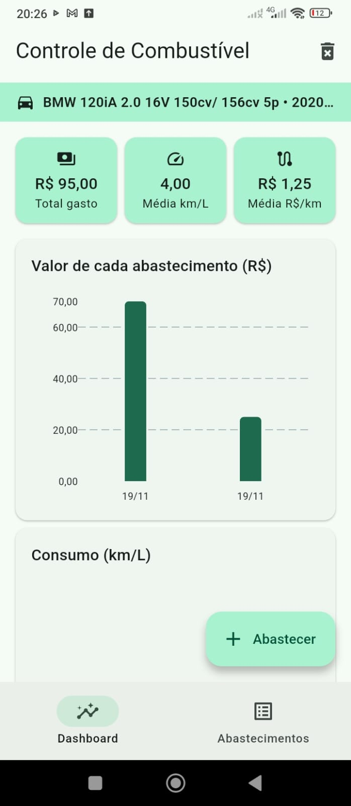
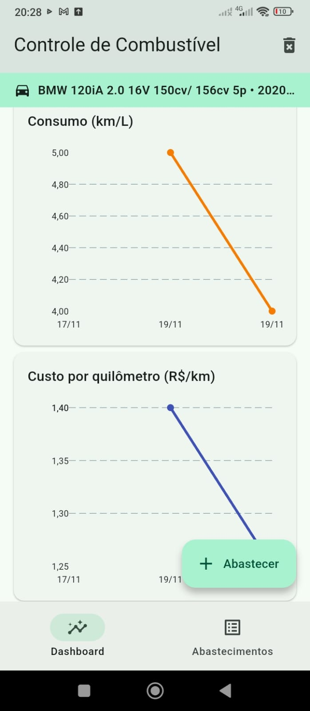

# Nome:
João Pedro Souza dos Anjos

# Controle de Combustível

Aplicativo Flutter para registrar abastecimentos de um veículo e acompanhar gastos e consumo ao longo do tempo.
Atividade Substitutiva da Prova 1 — Programação para Dispositivos Móveis II (Fatec).

## Descrição

- **Cadastro do veículo** (apenas um por vez): marca, modelo, ano e cilindrada. Marcas e modelos vêm da **BrasilAPI (tabela FIPE)**; os modelos listados dependem da marca escolhida. Para cadastrar outro veículo é preciso excluir o atual (com confirmação), o que também remove todos os abastecimentos dele.
- **Registro de abastecimentos**: tipo de combustível (etanol, gasolina ou diesel), preço por litro, quilometragem, litros e data/hora. O valor total (preço × litros) é calculado automaticamente.
- **Persistência local**: veículo e abastecimentos continuam salvos após fechar e reabrir o app.
- **Dashboard** com gráficos de: valor de cada abastecimento, consumo (km/L) e custo por quilômetro (R$/km). O primeiro abastecimento é só referência (sem km/L e R$/km). A partir do segundo:
  - distância = km atual − km do abastecimento anterior
  - km/L = distância ÷ litros do abastecimento atual
  - R$/km = valor total do abastecimento atual ÷ distância
- **Ícone** personalizado (bomba de combustível com gráfico).

## Como executar

Pré-requisitos: [Flutter SDK](https://docs.flutter.dev/get-started/install) (3.22 ou superior) e um emulador/dispositivo.

```bash
# 1) Na raiz do projeto, gera as pastas de plataforma, libera internet no Android,
#    instala dependências e gera o ícone do app:
dart tool/setup.dart

# 2) Executa
flutter run
```

Manualmente (equivalente ao script):

```bash
flutter create --project-name controle_combustivel --org br.fatec .
# Android: adicione em android/app/src/main/AndroidManifest.xml, antes de <application>:
#   <uses-permission android:name="android.permission.INTERNET"/>
flutter pub get
dart run flutter_launcher_icons
flutter run
```

Testes: `flutter test` (cálculo de valor total, km/L e R$/km).

## API e bibliotecas

| Item | Uso |
|------|-----|
| [BrasilAPI – FIPE](https://brasilapi.com.br/docs#tag/FIPE) | `GET /api/fipe/marcas/v1/carros` (marcas) e `GET /api/fipe/veiculos/v1/carros/{codigoMarca}` (modelos) |
| `http` | Requisições HTTP |
| `shared_preferences` | Persistência local (JSON) |
| `fl_chart` | Gráficos de barras e linhas |
| `intl` / `flutter_localizations` | Formatação em pt-BR (moeda, datas) |
| `flutter_launcher_icons` | Geração do ícone do app |

## Estrutura

```
lib/
  main.dart            # inicialização e rotas
  models.dart          # Vehicle, Refuel e cálculo dos indicadores
  app_state.dart       # estado (ChangeNotifier)
  storage.dart         # persistência local
  brasil_api.dart      # cliente da BrasilAPI
  screens/             # cadastro, home, dashboard, histórico, novo abastecimento
  widgets/series_chart.dart
```

## Capturas de tela

Adicione as imagens em `docs/screenshots/` e referencie aqui:

| Cadastro do veículo | Novo abastecimento | Histórico | Dashboard-1 | Dashboard-2 |
|---|---|---|---|---|
|  |  |  |  |  |
